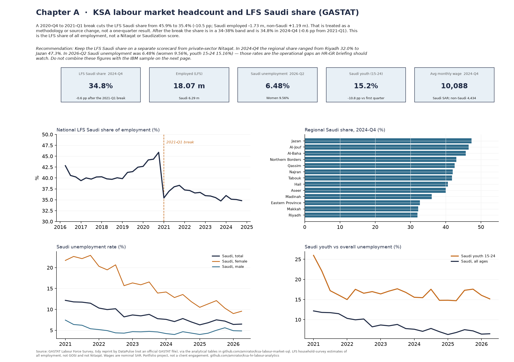
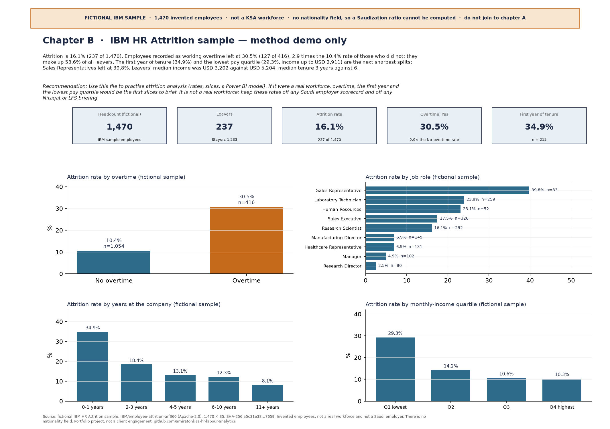

# KSA labour market and IBM HR attrition: a two-chapter analytics pack

**Business question:** What should an HR or HR-GR briefing take from official Saudi labour-market statistics, and what does a well-known public attrition sample show about drivers of leaving — without mixing the two into a fake company scorecard?

**Finding (chapter A, GASTAT LFS):** A single-quarter **break from 2020-Q4 to 2021-Q1** cuts the LFS Saudi share of all employment from **45.9%** to **35.4%** (-10.5 pp): Saudi employed changes by -1,730,601 and non-Saudi employed by +1,191,347. That jump is treated as a methodology or source change, not as a result. After the break the share sits in a 34-38% band and is **34.8%** in 2024-Q4 (-0.6 pp from 2021-Q1). In 2026-Q2 Saudi unemployment was **6.48%** (women 9.56%, youth 15-24 15.16%). This is the Labour Force Survey share of **all** employment. It is **not** a Nitaqat or Saudization score.

**Finding (chapter B, fictional IBM sample):** Attrition is **16.12%** (237 of 1,470). Employees recorded as working overtime left at **30.5%** (127 of 416), **2.93 times** the 10.4% rate of those who did not, and they make up 53.6% of leavers. The first year of tenure (34.9%, n=215) and the lowest monthly-income quartile (29.3%, income up to $2,911) are the next sharpest splits. Sales Representatives left at 39.8%. This is a **fictional IBM sample**, not a Saudi workforce, and it has **no nationality field**.

**Recommendation:** Keep three things on separate scorecards: the LFS Saudi share, private-sector Nitaqat, and any company attrition analysis. Use the IBM file only as a method demo for attrition rates and a Power BI model. Do not compute a Saudization ratio from either chapter, and do not join the two tables.





A two-page PDF of the same figures is in [`reports/hr_analytics_dashboard.pdf`](reports/hr_analytics_dashboard.pdf). Both pages are rendered in Python from the same model CSVs that the Power BI pack loads. There is **no `.pbix`** in this repository (Power BI Desktop is not available on Linux).

## The two chapters must stay apart

| Chapter | Data | What it can answer | What it cannot |
|---|---|---|---|
| A | GASTAT Labour Force Survey, via the analytical tables in [ksa-labour-market-sql](https://github.com/amirator/ksa-labour-market-sql) | National and regional **headcount**, the **LFS Saudi share of all employment**, unemployment, youth unemployment, nominal wages | A Nitaqat (private-sector Saudization) score; company-level attrition; anything about a named employer |
| B | IBM HR Attrition sample, 1,470 **fictional** employees, SHA-256 `a5c31e38bd7fafc9…` | Attrition rates and slices (overtime, tenure, pay, role) as a **method demo** | Anything about a Saudi employer; a Saudization ratio (there is **no nationality field**); a join to chapter A |

The Power BI model ships as two unconnected halves. `powerbi/model/DO_NOT_JOIN.txt` and the model diagram say the same thing.

## Chapter A — GASTAT LFS (official statistics)

The headline LFS Saudi share in 2024-Q4 is **34.79%**, on 18,070,431 employed of whom 6,286,358 are Saudi. A naive comparison with 2016-Q2 (42.82%, -8.03 pp) **crosses a break**: between 2020-Q4 and 2021-Q1 the share falls -10.48 pp. After 2021-Q1 it changes by only -0.62 pp. The 2021-Q1 step is reported as a data issue.

In 2024-Q4 the regional share ran from **Riyadh 31.97%** to **Jazan 47.32%**. In 2026-Q2 Saudi unemployment was **6.48%** (women **9.56%**, men 4.84%, gap 4.72 pp) and Saudi youth (15-24) unemployment was **15.16%** (8.68 pp above the all-ages rate, -10.82 pp from the first quarter of that series). Saudi paid employees averaged **SAR 10,088** a month against **SAR 4,434** for non-Saudis (ratio 2.28), in nominal riyals.

The sister SQL project documents that nationality and region totals reconcile exactly, and that the two unemployment files differ by at most 0.05 pp of rounding.

## Chapter B — IBM HR Attrition (fictional sample)

Overall attrition is **16.12%** (237 Yes, 1,233 No).

### Overtime (the sharpest split)

| Overtime | Employees | Leavers | Attrition |
|---|---:|---:|---:|
| Yes | 416 | 127 | 30.53% |
| No | 1,054 | 110 | 10.44% |

The Yes rate is **2.93×** the No rate. Overtime employees are 53.6% of leavers.

### Department

| Department | Employees | Leavers | Attrition |
|---|---:|---:|---:|
| Sales | 446 | 92 | 20.6% |
| Human Resources | 63 | 12 | 19.1% |
| Research & Development | 961 | 133 | 13.8% |

### Job role

| Job role | Employees | Leavers | Attrition |
|---|---:|---:|---:|
| Sales Representative | 83 | 33 | 39.8% |
| Laboratory Technician | 259 | 62 | 23.9% |
| Human Resources | 52 | 12 | 23.1% |
| Sales Executive | 326 | 57 | 17.5% |
| Research Scientist | 292 | 47 | 16.1% |
| Manufacturing Director | 145 | 10 | 6.9% |
| Healthcare Representative | 131 | 9 | 6.9% |
| Manager | 102 | 5 | 4.9% |
| Research Director | 80 | 2 | 2.5% |

### Years at the company

| Tenure | Employees | Leavers | Attrition |
|---|---:|---:|---:|
| 0-1 years | 215 | 75 | 34.9% |
| 2-3 years | 255 | 47 | 18.4% |
| 4-5 years | 306 | 40 | 13.1% |
| 6-10 years | 448 | 55 | 12.3% |
| 11+ years | 246 | 20 | 8.1% |

### Monthly income quartile

| Quartile | Employees | Leavers | Attrition |
|---|---:|---:|---:|
| Q1 lowest ($1,009–$2,911) | 369 | 108 | 29.3% |
| Q2 ($2,926–$4,908) | 366 | 52 | 14.2% |
| Q3 ($4,930–$8,376) | 367 | 39 | 10.6% |
| Q4 highest ($8,380–$19,999) | 368 | 38 | 10.3% |

Leavers had a median monthly income of $3,202 (mean $4,787) against $5,204 (mean $6,833) for stayers; a median tenure of 3 years against 6; and a median age of 32 against 36. Single employees left at 25.5% (n=470); frequent travellers at 24.9% (n=277).

These are slices of a **fictional** file. They are not evidence about any Saudi employer.

## Power BI pack

Power BI Desktop cannot run on this Linux build machine, so this repository does **not** contain a `.pbix`. The pack is ready to load on a Windows machine:

| Artefact | Path |
|---|---|
| Star-schema model CSVs (two unconnected halves) | [`powerbi/model/`](powerbi/model/) |
| Power Query M (one query per table) | [`powerbi/queries/`](powerbi/queries/) |
| DAX measures (chapter A and chapter B, clearly sectioned) | [`powerbi/measures.dax`](powerbi/measures.dax) |
| Model diagram (mermaid + PNG) | [`powerbi/model_diagram.png`](powerbi/model_diagram.png) |
| How to load, and the no-`.pbix` note | [`powerbi/README.md`](powerbi/README.md) |
| Python-rendered dashboards from the same model | `reports/dashboard_lfs.png`, `reports/dashboard_ibm.png`, `reports/hr_analytics_dashboard.pdf` |

A `.pbix` will be added if it is built later on a Windows machine. Until then, any claim that a `.pbix` already exists would be false.

## Data, licence and period

| Chapter | Official / origin | What is in this repo | Rows | Period / grain | Licence |
|---|---|---|---:|---|---|
| A | GASTAT Labour Force Survey, tidy reprint by [DataPulse](https://datapulseactive.com/en/data/open/) | Slim analytical tables in [`data/gastat/`](data/gastat/), produced by [ksa-labour-market-sql](https://github.com/amirator/ksa-labour-market-sql) | employment 35 national quarters, 455 region-quarters; unemployment to 2026-Q2 | Employment 2016-Q2–2024-Q4; unemployment 2021-Q1–2026-Q2 | [GASTAT use policy](https://www.stats.gov.sa/en/use-policy) (Arabic text governs) |
| B | IBM, via [IBM/employee-attrition-aif360](https://github.com/IBM/employee-attrition-aif360) | Frozen [`data/ibm/emp_attrition.csv`](data/ibm/emp_attrition.csv) | 1,470 × 35 | Cross-section, no calendar date | Apache-2.0 on that repository; the file is a fictional sample |

SHA-256 of the IBM file: `a5c31e38bd7fafc9bc333884eb181b06b41b8e5e488e8f7ccb27199fb3be7659`. Details and the DataPulse / GASTAT citation are in [`data/ibm/SOURCE.md`](data/ibm/SOURCE.md) and [`data/gastat/SOURCES.md`](data/gastat/SOURCES.md). No rows were dropped from either source. The IBM file is used as published; analysis bands (`TenureBand`, `IncomeQuartile`, `AttritionFlag`) are added only in the model copy.

## How to run

```bash
python -m venv .venv && source .venv/bin/activate
pip install -r requirements.txt
python run.py      # model CSVs, kpis.json, dashboards, README
python -m pytest -q
```

CI (GitHub Actions) runs the same two commands on every push.

## Limitations

- **Chapter A is a household survey**, with sampling error. It is not a GOSI register and it is not Nitaqat. A falling LFS Saudi *share* can sit alongside a rising private-sector Saudization *score*, because coverage and the denominator differ (this series includes domestic workers, the self-employed, and the public sector).
- **2020-Q4 to 2021-Q1 is a break** in the LFS employment series (-10.48 pp in one quarter). Comparisons that cross 2021-Q1 should be made only with that caveat. The full discussion and the reconciliation checks live in the sister SQL project.
- Employment and wages end in **2024-Q4**; unemployment runs to **2026-Q2**. The two windows are stated next to every figure.
- Wages are **nominal** SAR, not adjusted for hours, occupation or inflation.
- **Chapter B is fictional.** The attrition rates describe invented IBM employees. They are not KSA rates and they are not used to estimate a Saudi company's attrition or Saudization.
- The two chapters **must not be joined**. This repository never computes a "company Saudization" figure.
- The tidy GASTAT CSVs used upstream are a **third-party reprint**, not an official GASTAT file.
- There is **no `.pbix`**. Dashboards are Python renders of the same model.
- This is an independent portfolio project. It is not a client engagement, not employment, and not affiliated with GASTAT, DataPulse or IBM.

## Author

Mohammad Amir Khan, Jeddah · [GitHub](https://github.com/amirator) · [LinkedIn](https://www.linkedin.com/in/amir-khan-a31363235/)

MIT licence (code). Data: GASTAT (via the policy above) and the fictional IBM sample (Apache-2.0 on the upstream repository).
